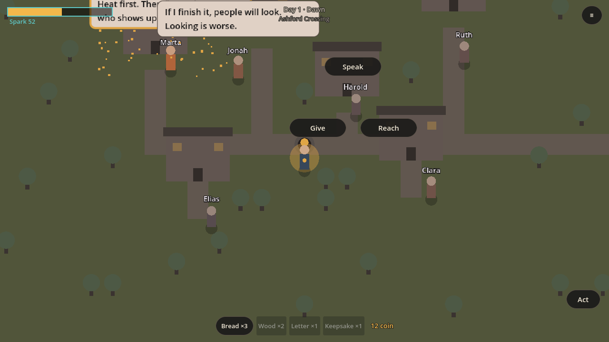

# The Last Spark: Godot port of v2 (`godot/`)

A Godot 4.3 (GDScript) port of the v2 rebuild in `game/`. It reads the same JSON content tables and
keeps the v2 rules: news through people, one ring with at most 6 chips, a minimal HUD, and despair
shown as a palette shift on the town.



## Run
1. Install Godot 4.3+ (standard build, not .NET).
2. Open `godot/project.godot` in the editor and press F5, or run `godot --path godot` from the repo root.

Controls: WASD/arrows or tap to walk. E/Space (or the **Act** button) opens the ring on the nearest
person, hearth or signpost; tapping a thing walks to it and then opens its ring. Esc pauses. Tap an
edible item in the hotbar to eat it for spark.

## Test
```bash
godot --headless --path godot -s res://tests/run_tests.gd          # rules + RNG parity with TS
xvfb-run godot --path godot -s res://tests/screenshot.gd -- out.png  # render check
```
`run_tests.gd` checks that `SeedRng` produces exactly the same stream as `game/src/sim/rng.ts`
(mulberry32 + FNV-1a `deriveRng`), so seeded results can match between the two builds.

## Content
`godot/data/` is a copy of the tables it uses from `game/src/data`. The TypeScript game is still the
source of truth: after changing content there, run `godot/tools/sync-data.sh`.

## Layout
| Godot | Ported from (`game/src`) |
|---|---|
| `scripts/core/rng.gd` | `sim/rng.ts` (exact) |
| `scripts/core/data.gd` | `sim/load-data.ts` (people, towns, items, methods, wounds, player) |
| `scripts/core/sim.gd` | `sim/methods.ts` commitMethod, gift affinity, rest/relapse, `sim/save.ts` |
| `scripts/world/town_map.gd`, `palette.gd` | `world/` terrain, settlements, despair palette (`docs/art/PALETTE.md`) |
| `scripts/actors/person.gd`, `player.gd` | `actors/` villagers, player keys + tap-to-walk |
| `scripts/ui/ring.gd` | `interact/` ring (families, ≤6 chips, back chip) |
| `scripts/ui/bubble.gd` | `voice/` speech bubbles |
| `scripts/ui/hud.gd`, `menu_sheet.gd`, `kit.gd` | `ui/` HUD, kit, pause/title/end sheets |
| `scripts/main.gd` | `app/shell.ts` (focus, input, wiring) |

## What is ported, and what is not yet
**Playable now:** Ashford, Lowmere and Marrow's Den from `towns.json`, with the 11 authored people
from `people.json`. You can speak, use the five methods (spark cost, wound effectiveness, fuzz,
backfire with the resentment mark), and give items, scored by `giftAffinity`. Eating restores spark,
and people reignite with a burst and their own line. You can rest at the hearth (dawn relapse and
drift), travel by signpost, play day and night light, save and load (`user://save.json`), and reach
the burnout or all-kindled ending. Touch works through the Act and menu buttons and tap-to-walk.

**Not ported yet:** most of `game/src/sim` (about 33k lines). That covers the economy, logistics,
companies and households; the polity, doctrine and borders; the realm and district worldgen; letters,
rumours and the chronicle; marks beyond resentment; refusal hooks; interiors; crafting and land acts;
roads and encounters; the hoarder; succession; animals, carts and sound. Each one can be ported module
by module into `scripts/core/` against the same JSON. The `rng.gd` parity test is the base for
checking ported modules against the TS output.
